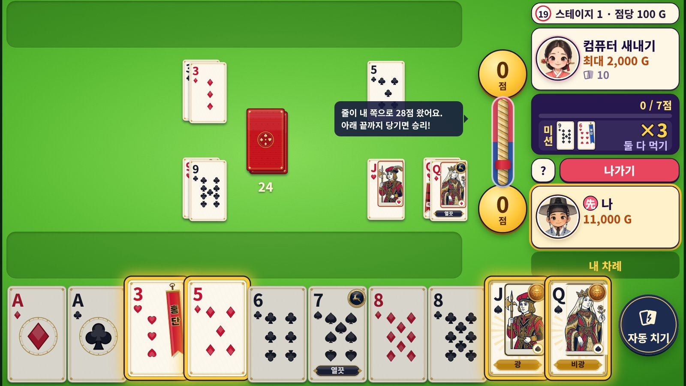
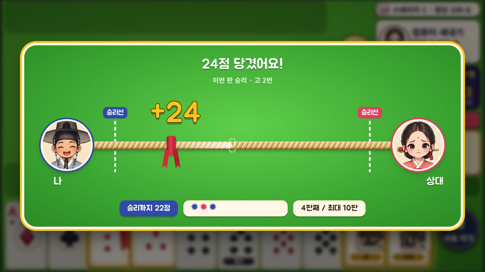
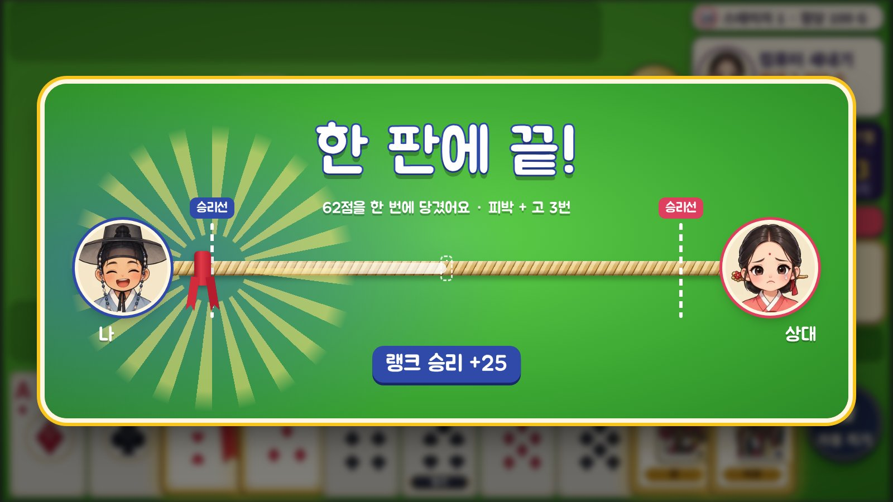

# 37. 트럼프 고스톱 — 랭크 대전 티어·LP 설계 (비즈니스 기획팀)

> 2026-10-25 대표 지시: "호칭과 방식은 롤을 따라 하면 되겠다(호칭·승급전 등 여러 룰)". docs/36 4절(랭크 대전)의 숫자를 이 문서가 정해요.
> **방식(배치·티어·디비전·승급전·강등 보호·시즌)은 롤과 같은 틀**로 하고, **티어 이름·그림은 우리 것**으로 만들어요(CLAUDE.md 규칙 4: 상용 게임 이름 베끼기 금지 — 아이언·브론즈·챌린저 같은 롤 이름은 쓰지 않음).
> 숫자는 기획팀 추천 **잠정안**이에요. 대표 확인 뒤 결정로그에 확정으로 올려요.

## 1. 경기 방식 — 줄다리기 (2026-10-25 대표 결정)

```
나 ◀── 승리선 50 ──────── 가운데 ──────── 승리선 50 ──▶ 상대
```
- 판을 이기면 **그 판 점수만큼 줄을 내 쪽으로** 당긴다. 상대가 이기면 상대 쪽으로 끌려간다.
- 줄(가운데 붉은 천)이 **내 쪽 승리선(점수 차 50)을 넘으면 경기 승리.**
- **한 판 최대 점수는 없다** — 50점 넘는 대박 한 판이면 **한 판에 끝**(대표: "한 판에 끝나야 재미가 있어").
- **최대 10판.** 10판이 끝나도 승리선을 못 넘으면 그때 줄이 자기 쪽에 있는 사람이 승리(같으면 마지막 판 이긴 사람).
- 승급전 = 점수 차 70 · 최대 12판.
- 선(先)은 첫 판 씨앗, 다음 판부터 이긴 사람(고스톱 규칙). 나가리 판은 줄이 움직이지 않음.

### 1-1. 시뮬레이션 (AI끼리 600경기, 한 판 약 2분 30초로 잡음)
| 방식 | 평균 판 수 | 90% | 한 판에 끝 | 최대 판 수로 끝 | 고급 vs 초급 |
|---|---|---|---|---|---|
| 한 판 승부(비교) | 1 | 1 | — | — | 73% |
| **보통: 차 50 · 최대 10판** | **5.0판(약 13분)** | 10판 | **9%** | 12% | 81% |
| **승급전: 차 70 · 최대 12판** | **7.3판(약 18분)** | 12판 | 4% | 23% | 86% |

- 한 판 점수 꼬리가 길어서(중앙 16 · 95% 80 · 최대 704점) 대박 한 판으로 끝나는 경기가 열에 하나쯤 — 그게 이 방식의 재미.
- 줄다리기는 판이 쌓일수록 실력이 조금 더 드러나요(한 판 73% → 경기 81%). 고스톱 운 요소는 그대로 크고요.
- (지난 안이던 '먼저 50점 경주'·'판당 상한'은 버림.)

### 1-2. 화면 시안 (디자인 시안 v1, 2026-10-25)
지금 게임 색(초록 판·크림 칸·금색 동전·남색/빨강 편 색)과 캐릭터(선비 소년·각시)를 그대로 써서, **누구 쪽으로 줄이 왔는지** 한눈에 보이게 했어요. 줄은 볏짚 새끼줄, 가운데 표시는 붉은 천(실제 줄다리기 중심 표시).

| 판 위 상시 표시 | 판 끝 당기기 연출 | 한 판에 끝 |
|---|---|---|
|  |  |  |

- **판 위:** 두 점수 동전 사이를 세로 줄로 잇는다(위 = 상대, 아래 = 나 — 지금 화면 배치와 같은 방향). 붉은 천이 내 쪽으로 내려올수록 이기는 중.
- **판 끝:** 화면 가운데에 가로 줄다리기 판. 이번 판 점수(+24)가 날아가 천이 지난 자리(점선)에서 새 자리로 끌려간다. 아래 줄: 승리까지 남은 점수 · 판별 승패 점(파랑 = 나, 빨강 = 상대) · 몇 판째 / 최대 10판.
- **한 판에 끝:** 천이 승리선을 넘는 순간 햇살 터짐 + "한 판에 끝!" + 랭크 결과.
- 그림은 HTML/CSS 시안(새끼줄·천은 코드로 그림 → 게임에 바로 옮길 수 있음). 움직임: 천이 끌려갈 때 0.6초 · 줄이 살짝 출렁 · 캐릭터 표정(웃음/울상)은 기존 `TG_FACE`.

## 2. 티어 (아래 → 위)

| # | 티어 | 영어(확정 2026-10-25) | 디비전 | 비고 |
|---|---|---|---|---|
| 1 | 나무 | Wood | IV~I | 맨 아래(더 내려가지 않음), 초보 보호 |
| 2 | 돌 | Stone | IV~I | 초보 보호 |
| 3 | 구리 | Copper | IV~I | |
| 4 | 은 | Silver | IV~I | |
| 5 | 비취 | Jade | IV~I | 배치로 갈 수 있는 최고 |
| 6 | 진주 | Pearl | IV~I | |
| 7 | 금강 | Diamond | IV~I | 미접속 감소 시작 |
| 8 | 달인 | Elite | 없음(LP 무제한) | |
| 9 | 대가 | Virtuoso | 없음 | 출시 초기엔 LP 기준, 사람이 늘면 상위 순위 기준 |
| 10 | 국수(國手) | Kuksu (부제 *National Champion*) | 없음 | 출시 초기엔 LP 기준, 사람이 늘면 상위 50명 |

- 이름 고른 이유: 금속·보석 계단은 누구나 알아보는 일반 낱말이고, 맨 위 **국수**는 바둑에서 '나라 최고수'를 부르는 한국 말이라 우리 게임 색이 나요.
- **금(Gold)은 티어 이름으로 쓰지 않아요** — 게임 돈 단위 골드(G)와 헷갈려요. 같은 이유로 컴퓨터 이름(새내기·고수·타짜), 골드 칭호(동네 새내기·사랑방 고수·장터 명인·큰손·전설의 손)와 겹치는 낱말도 피했어요.
- 영어 이름 고른 이유: 1~7단계는 뜻이 바로 통하는 낱말(Diamond는 여러 게임이 쓰는 일반 낱말). 8·9단계는 **컴퓨터 이름 CPU Master와 겹치지 않게** Master·Grandmaster 대신 Elite·Virtuoso. 맨 위 Kuksu는 한국 게임 개성 — 휘장에 *"Kuksu — National Champion"*. 문구 키는 `docs/34_영어문구사전.md` 18절.

## 3. LP 규칙

| 항목 | 규칙 |
|---|---|
| 디비전 크기 | 100 LP |
| 이기면 | 기본 **+25 LP**, 실력 차(MMR)로 ±10 조정 — 강한 상대를 이기면 더 |
| 지면 | 기본 **−20 LP**, 실력 차로 ±10 조정 — 강한 상대에게 지면 덜. **나무·돌은 −10**(초보 보호) |
| 상금 출처 | 시스템이 줌. 진 사람이 잃은 LP는 상대에게 가지 않고 사라짐(docs/36 4-2) |
| 디비전 오르기 | 100 LP가 되면 **바로** 다음 디비전(예: 구리 III → 구리 II) — 승급전 없음 |
| 티어 오르기 | 디비전 I에서 100 LP → **승급전 1경기**(목표 70점). 이기면 다음 티어 IV 0 LP, 지면 75 LP로 |
| 강등 | 0 LP에서 지면 한 디비전 아래(75 LP). 티어 경계(IV → 아래 티어 I)는 **승급 직후 3경기 강등 보호** |
| 달인 이상 | 디비전 없음, LP 무제한. 대가·국수는 출시 초기엔 LP 기준(예: 달인 200 LP·500 LP), 랭크 대전 사람이 늘면 상위 순위 기준으로 |
| 미접속 감소 | 금강 이상, 28일 동안 랭크 경기가 없으면 일주일마다 −50 LP(금강 IV 아래로는 안 내려감) |

### 3-1. 배치고사
- 첫 시즌·새 시즌 처음 **5경기는 티어 없이** 배치고사. 결과로 시작 티어를 정해요(최고 비취 IV).
- 배치 동안은 MMR만 움직이고 LP는 보이지 않아요.

### 3-2. 경기 매너
| 행동 | 처리 |
|---|---|
| 매칭을 잡고 수락 안 함·취소(닷지) | −5 LP, 반복하면 5분 → 30분 매칭 금지 |
| 경기 도중 나가기·창 닫기 | 그 경기 **패배** + 추가 −10 LP(지금 대전 골드 벌점 점당 ×10 대신, docs/36 4-3). 강제 종료는 다음 실행 때 정산(E-5와 같은 방식) |
| 같은 상대 반복 | 같은 상대와는 하루 3경기까지만 랭크 매칭 |

## 4. 시즌

- 시즌 = **3개월**(분기). 시즌 끝에 **소프트 리셋** — 모두 Wood로 돌아가는 게 아니에요.
  - 숨은 실력 점수(MMR)는 **남기고 가운데 쪽으로 조금 당겨요**(차이를 줄임).
  - 새 시즌 첫 5경기 = 배치고사. 남은 MMR + 배치 결과로 시작 티어를 정해요. 시작 티어는 **최대 Jade IV**.
  - 그래서 지난 시즌 Kuksu였던 사람도 Jade IV 근처에서 시작해 빠르게 다시 올라가요(이길 때 LP를 많이 받음). 지난 시즌 Stone이었던 사람은 Stone 근처에서 시작해요.
  - 모두 Wood로 되돌리는 **완전 리셋은 하지 않아요**: 고수가 낮은 티어 신규를 몇 주 동안 휩쓸어서 초보가 떠나요.
  - 지난 시즌 기록은 사라지지 않아요: 프로필에 **시즌별 최고 티어 휘장**이 계속 남고, 시즌 보상 꾸미기도 영구 소장.
- **시즌 보상**(시즌 중 최고 도달 티어 기준, 판 결과와 무관한 꾸미기만):
  - 은 이상: 시즌 카드 뒷면
  - 비취 이상: + 테이블 테두리
  - 금강 이상: + 시즌 칭호
  - 달인 이상: + 프로필 금테·시즌 순위 기록
- 시즌 보상은 골드·충전권·LP로 주지 않아요(docs/36 2절).

## 5. 화면 (UI 기획팀이 이어서 정할 것)
- 대전 결과 창: 티어 휘장 + LP 막대 변화(+25 / −20), 승급전·강등 보호 남은 경기 표시.
- 판 위 줄다리기 표시·판 끝 연출·한 판에 끝 연출 = 1-2 시안을 바탕으로 UI 기획팀이 문구·크기(휴대폰 390px 포함)를 정함.
- 티어 휘장 그림 10종(디자인팀, 오리지널), 승급 연출(효과·사운드팀).

## 6. 개발팀 할 일(docs/36 7절에 더함)
- `hp:tg:rank` 저장(티어·디비전·LP·MMR·보호 경기 수·배치 남은 경기·시즌 번호).
- 줄다리기(`g.sess`): 줄 위치 = 판 점수 합산(+ 나 / − 상대), 점수 차 50 승리 · 최대 10판, 승급전 70 · 12판.
- MMR·LP 계산은 **서버에서** 해야 조작을 막을 수 있어요(지금 골드처럼 기기 저장이면 순위표가 의미 없음) → `server/` 검토, 대전 짝짓기 `dv` 올림, `npm run test:duel` 필수.

## 7. 대표 확인이 필요한 것
1. ~~경기 방식~~ → 줄다리기 확정(결정로그 276).
2. ~~티어 이름~~ → 확정(결정로그 275). 남은 것: 레벨 포인트 영어 이름(아래 8절).
3. LP **+25 / −20**, 나무·돌 초보 보호 −10.
4. 시즌 3개월, 보상 목록.

## 8. 영어 용어 — 정할 것 (UI 기획팀 검토)
- 랭크 경기 = **Ranked Match**(여러 hand로 된 한 경기 — `match`는 '한 판' 뜻으로는 계속 쓰지 않음), 티어 = **Tier**.
- **레벨 포인트 영어 이름**: 'LP'는 롤의 고유 용어(League Points)라 피하는 게 좋고, 'points'는 판 위 점수와 겹쳐요. 추천 = **Honor**(명예, 예: `+25 Honor`) — 친구 방 '체면' 테마와도 이어져요.
- **골드 칭호의 영어 'Rank'**(docs/34 0-4)가 랭크 대전(Ranked)과 헷갈려요 → 골드 칭호 영어를 **Title**로 바꾸는 걸 추천(0-4의 '쓰지 않음: Title'을 뒤집는 일이라 대표 확인 필요).
